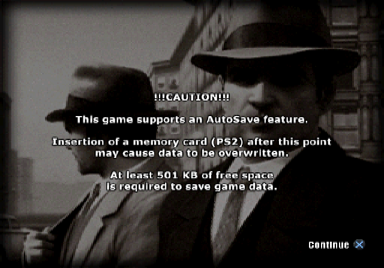

# Mafia PS2 Native Recomp

Static recompilation of the original PlayStation 2 **Mafia** executable for Linux and Apple Silicon macOS. The original EE game program is translated to C++ by a pinned [PS2Recomp](https://github.com/ran-j/PS2Recomp) revision and linked with its PS2 runtime.

**Status: original frontend graphics on Linux; main menu and gameplay remain unverified.** The complete translated program loads the original ELF, executes its startup and IOP service modules, and renders the original autosave caution screen with its CONTINUE Cross prompt. A longer run passes its automatic dismissal and reaches the original memory-card query, where an unsupported secondary DMA transfer currently stops execution. Source, host and runtime regression tests also pass on ARM64 macOS through patch 0028; the complete original game corpus has not been run there. Read [the verified progress report](docs/PROGRESS.md) for exact execution evidence and remaining work.



Actual 640×448 GS capture from the original program on Linux, encoded as PNG with identical RGB pixels. This 120-second run reached the frontend screen without a strict execution failure. The later memory-card stop occurs before another screen is presented; main-menu entry and controller input remain unverified. The capture path also works without a display server; the earlier Gathering splash is retained in the progress report.

## Build from your own disc

Requires Python 3.11+, CMake 3.24+, Git, a C++20 compiler and FFmpeg development libraries. The verified Linux host is x86-64; the Linux scripts also accept ARM64, which has not yet been exercised with the original game.

On Ubuntu 24.04:

```sh
sudo apt install build-essential cmake python3 git pkg-config \
  libx11-dev libxrandr-dev libxinerama-dev libxcursor-dev libxi-dev \
  libgl1-mesa-dev libasound2-dev libavcodec-dev libavformat-dev \
  libavutil-dev libswresample-dev libswscale-dev zlib1g-dev
export MAFIA_PS2_ISO="/absolute/path/to/Mafia.iso"
python3 tools/bootstrap.py --diagnostic
bash tools/build_linux.sh
bash tools/run_linux.sh
```

On Apple Silicon:

```sh
brew install python cmake pkg-config ffmpeg
export MAFIA_PS2_ISO="/absolute/path/to/Mafia.iso"
python3 tools/bootstrap.py --diagnostic
bash tools/build_macos.sh
bash tools/run_macos.sh
```

Bootstrap reads `SYSTEM.CNF`, verifies the boot ELF, extracts the disc locally, fetches exact dependency commits, applies the reviewed patches, builds the real analyzer/recompiler and generates C++. It does not download games or BIOS files. The generated corpus and extracted files stay in ignored directories. Allow several gigabytes for the disc, extracted data, generated C++, object files and dependencies.

The current profile accepts **SLUS-20671, VER 1.01**, and only the exact ELF SHA-256 in [the profile](profiles/slus-20671.json). Other builds fail with their observed hash so they can receive separate profiles. A matching filename is insufficient.

`MafiaNative.app` is a developer build using locally installed FFmpeg libraries. Packaging a self-contained app and running the original game corpus on Apple Silicon remain separate milestones. F11 toggles fullscreen. The host presents pixels produced by the upstream GS and preserves the framebuffer aspect ratio; no substitute title scene is included.

For a bounded headless Linux run after building (use `run_macos.sh` on macOS):

```sh
bash tools/run_linux.sh \
  --elf .work/extracted/SLUS_206.71 \
  --data-root .work/extracted \
  --iso "$MAFIA_PS2_ISO" \
  --headless --timeout-ms 10000 --report .work/runtime.json \
  --capture-frame .work/frame.ppm
python3 tools/symbolize_report.py .work/runtime.json \
  --elf .work/extracted/SLUS_206.71
```

Timeouts, unresolved function dispatch and unsupported services return nonzero exit codes. `--validate-only` verifies input identity without claiming execution. `--timeout-ms 0` disables the execution deadline for interactive investigation. Frame capture writes the actual GS presentation surface as lossless PPM; it reports unavailable output explicitly and refuses to overwrite an existing file. A captured black frame alone is not evidence of successful rendering.

## Inspect and test

```sh
python3 tools/prepare_iso.py "$MAFIA_PS2_ISO" --output .work --extract boot
python3 tools/analyze_elf.py .work/extracted/SLUS_206.71 --external-tools
bash tools/test.sh
```

`--extract boot` is explicitly incomplete and is suitable for analysis only. Full extraction preserves original paths and rejects ambiguous case/version aliases. The reader also provides checked logical-sector reads. Runtime raw CD/DVD reads still require the original ISO.

`tools/recompile.sh` supports `--elf`, `--work`, `--upstream`, `--tools-build` and an optional external `--function-map`. By default it exports the retained function symbols plus reviewed boot-code boundaries. It uses PS2Recomp's CSV format without claiming that Ghidra was run. For a stripped executable, obtain reviewed boundaries with upstream's `ps2xRecomp/tools/ghidra/ExportPS2Functions.java` and create an exact build profile first.

CI runs source-only Python/C++ tests and synthetic runtime contracts on Linux and ARM64 macOS. Its separate `MafiaHostContract.app` compiles the real native host with an authored test ELF and checks ARM64 architecture, bundle metadata, input verification and entry dispatch. It never downloads or uploads commercial fixtures. Game milestones require separate evidence from the original program.

## Design and license

[Architecture](docs/ARCHITECTURE.md) explains the profile, generator, host and runtime boundaries. Generic upstream corrections live in `patches/`; game identity and reviewed boot ranges live in `profiles/`. The source and patch set, generated source files and runtime ELF each have an integrity gate.

This project is GPL-3.0; see [LICENSE](LICENSE). PS2Recomp is GPL-3.0. Dependency identities are in [dependencies.lock.json](dependencies.lock.json); their own licenses remain applicable. [VCS Recomp](https://github.com/OverkillLabs3/vice-city-stories-recomp) was studied for architecture. Its PSP graphics code and separately licensed shaders are not copied into this project.

No ISO, ELF, IRX, BIOS, extracted asset or binary-derived C++ is tracked. The screenshot above documents an actual run; it is not a runtime asset. Tests construct their own small executables and discs.
