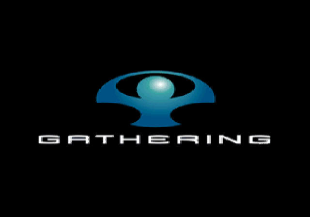

# Verified progress

Evidence collected on **2026-10-27**. The original translated game now renders its **autosave caution screen on Linux x86-64**, beyond the earlier Gathering splash. Main-menu entry, controller input and gameplay remain unverified. The current Linux build uses GCC 13.3; Apple Silicon remains a supported build target with separate execution evidence.

## Execution status

| Milestone | Current evidence |
| --- | --- |
| Verify and load the actual ELF | Passed: exact original SHA-256 and ELF headers checked by the native host. |
| Execute original entry and main | Passed: original entry 0x00100008 and original main execute. |
| Initialize IOP services | Original LOADFILE, CDVDFSV and FILEIO execute their entry functions and register their RPC services. Later game-supplied IRX modules also execute. The kernel/reset model is described below. |
| Render original startup/frontend graphics | Passed: both the Gathering publisher splash and the original autosave caution screen are captured from the actual GS presentation surface. |
| Complete initialization and enter the main menu | Not yet verified; the timed caution screen closes, then the first original memory-card query reaches an unsupported secondary DMA transfer. |
| Missions, player, vehicles, objectives, saves and all modes | Not verified. |

All **7,791 translated game functions** compiled and linked into the native Linux executable. The diagnostic build uses -O0 -g0 and unity batches of 32. Runtime corrections reuse the same 245 compiled game objects; every object digest and its transitive upstream include dependencies are checked against the retained build inputs. The original EE code has not been edited or replaced with native SDK functions.

### Latest actual screenshot

The 120-second patch-0028 run produced this original **640×448** screen with its
CONTINUE Cross prompt, background artwork and text. Two independent reviews
verified the image. PNG conversion preserves every RGB byte; no pixels were
added, removed or scaled.

| Frontend capture provenance | SHA-256 |
| --- | --- |
| Raw source PPM | fe1033ac946a2a5f8cb7a5cb3a2404320ceda20e75a3f8cbb58ba8e184c512ec |
| Published PNG | 37a3794c9a6247da57cfc5c78ba2a7edc38cc35ec279eda47157fe2aeda20a32 |
| Decoded RGB bytes | 3c04a90c81cc3236b4215c7691ee47e7691e4c8c0a188b551313019e1f3a2c6e |

### Earlier startup screenshot

This is the original **640×448** startup splash, captured headlessly and encoded as PNG with exactly the same RGB pixels. It is not a menu or gameplay screenshot.

| Capture provenance | SHA-256 |
| --- | --- |
| Raw source PPM | 67ff60d1d8e3f3c114e4fcfdef6aa4b68b960321d1efd3b697d0e8b431d4c39d |
| Published PNG | af7aab0d84b7a2b12744f7847e097231f14ce3ca1d09ac6489ce4e80fcf44ea8 |
| Decoded RGB bytes | 7e2ab2785b7132569849a08f9f0c56fbe98cc6e8bcc6f5e12d291e87faac81b2 |

The captured image has 21,092 nonblack pixels and was checked visually and against its raw pixels by independent reviewers. A later frame after sound initialization begins has slightly different pixels from the splash animation, but still shows the same startup logo. A nonblack count alone is never treated as proof of a correct game frame. The host's automatic game_frame_verified and gameplay_verified fields remain false; the manually reviewed startup image is a separate milestone. Headless execution has no window presentations.

### Latest original-program run: patches 0001–0029

The longer Linux run passes the caution screen's automatic dismissal and
executes the original memory-card query. It stops at a precise unsupported
transport operation before presenting another screen. This is observed original
control flow, not a successful memory-card or menu claim.

| Observation | Recorded result |
| --- | --- |
| Process status | Strict transport failure after 360.825 wall seconds, before the requested 480-second deadline |
| Error | `Physical IOP packet RPC: callback SIF DMA requires an ordered packet transport` |
| Original call chain | `sceMcGetInfo` → original MCSERV RPC `0x80000400`, function 1 |
| EE sample at failure | `sceSifSetDma`, `0x004057E8`; branch from `_sceSifSendCmd`, `0x004079E4` |
| Hardware work | 208,266 DMA starts; 14,070 GIF copies; 91,698 VIF writes |
| IOP snapshot | 15,233,832 interpreted instructions; 11 loaded-module records; 30 threads; 15 RPC servers |
| Last displayed surface | The caution image remains at VBlank 1,735; no newer screen was presented |
| Native executable size | 219,166,672 bytes |
| Native executable SHA-256 | `4f69a627b2aabbd50439c099d09faa817c18f37b9103dfd4fb9637069f7e23b7` |

The original stack contains the `sceMcGetInfo`, `MC_CheckMemCards` and subsequent
`ExecuteMenu` continuation. Its server and request-buffer addresses match the
original resident MCSERV module. That handler issues a 192-byte IOP-to-EE DMA
transfer before its RPC completion; the physical packet path currently rejects
such callback transfers. The separate modeled host memory-card service is not
on this original path, so its formatted-card defaults do not establish the
outcome of this scan.

This run uses optimized runtime/IOP/GS libraries (`-O2 -g0`, assertions retained)
and the same verified 245 game objects at `-O0`. A preceding patch-0028 optimized
240-second run still showed the caution screen with original `timeGetTime`
returning 20,618 ms. The unoptimized 360-second run reached 8,220 ms. Those are
original timer readings since its initialization, not time spent on the warning
or a frame-rate measurement. The latest frame's raw PPM SHA-256 is
`afd74791069e028d9f1a545255c6b9310d4a4ead7839218e5c36094882f497f4`;
the published screenshot above retains its separately identified patch-0028
capture provenance.

### First original frontend capture: patches 0001–0028

The actual native program reaches the original autosave caution screen and
continues rendering until the requested diagnostic deadline. It no longer
stops at the corrupted SIF return or at the CDVDMAN tray-change query.

| Observation | Recorded result |
| --- | --- |
| Process status | Clean diagnostic timeout at 120.630 wall seconds; no strict execution failure |
| Original frontend | Autosave caution screen, with CONTINUE Cross prompt |
| EE sample at shutdown | `RBuffProcessOneDmaCommand__9LSIDeviceFb`, `0x003E8F60` |
| Last branch source | `DmaSendToVif__9LSIDeviceFUi`, `0x003EF3D4` |
| EE scheduler | Main thread running; no semaphore waiters |
| Hardware work | 14,129 DMA starts; 528 GIF copies; 2,907 VIF writes |
| IOP snapshot | 10,116,180 interpreted instructions; 11 loaded-module records; 30 threads; 15 RPC servers |
| Latest GS capture | 640×448, VBlank 1,494, framebuffer page 140, 220,652 nonblack pixels |
| Native executable size | 224,400,648 bytes |
| Native executable SHA-256 | `1d85f2df307d0103e1a6a5d6c662cdd943e9d5b40801c245f73440918e1026c1` |

The original caution screen also has a 25,001-millisecond game-time dismissal
path. Its timer is driven by the original EE timer interrupt. VBlank 1,494 is
less than 25 seconds since startup, while the caution screen is created later;
the 120-second wall-time limit therefore does not establish a stuck screen.
The later patch-0029 run verifies the automatic transition and reveals the
memory-card transport failure described above. A sampled rendering function
and a single hardware snapshot are not treated as proof of a deadlock.

Original controller input is a separate unverified path. Review found that
the existing host pad override feeds only the EE SDK replacement; this profile
disables that replacement. The original PADMAN/SIO2 route still needs an actual
controller-device connection. No simulated button press through an unused
helper is reported as successful original input.

#### Corrections that enabled this screen

Patch 0024 reuses freed IOP allocations; four authored churn/fragmentation cases
fail before it and pass afterward. Patch 0025 retires delayed register loads
before modeled imports or original exports; its four new instruction cases
also reproduce the former failures. The missing original animation preload
was restored and hash-verified. Patch 0026 preserves the optical driver's
read-only backing and supplied-export precedence; review corrected an initial
implementation that shadowed foreign file handles.

Patch 0027 fixes the confirmed EE stack collision. Original `_start` owns
`[0x01F00000, 0x02000000)` as its main stack; the former callback pool used the
same interval. A legitimate FILEIO tail copy overwrote the SIF handler's saved
return address. Callbacks now use a bounded, separately owned kernel arena,
preserving the original alarm patch and coordinating reset and lease reuse.
All eight new regressions fail against the former runtime and pass with the
correction. The actual original program passes the corrupted-return location.

Patch 0028 implements the next observed request, `sceCdTrayReq` mode 2, from
original `G_LoadSaveClass::Init`. It consumes the driver's initial media-change
notification and preserves output bounds, controller state and original
export precedence. Six new behavior cases fail before the fix; the complete
eight-case suite passes afterward. Physical tray movement remains unsupported.
The previous 52-file and 54-file runs stopped at the identical missing request;
after the fix, the 54-file run reaches the screen above.

Patch 0029 corrects a separate idle-scheduler ordering error: the earliest
guest-cycle deadline must win before comparing host-clock deadlines. Two
authored periodic-timer regressions fail against the previous runtime; all 21
interrupt cases pass with the correction. The full runtime suite passes 521
cases in both `-O0` and `-O2` builds. Host wait pacing remains enabled. This fix
does not establish a general solution to the cost of software rendering.

Fresh runtime and host code were linked with 245 unchanged game objects. All
object digests, actual transitive upstream include dependencies and 7,794
generated source/header hashes were checked. Launches record the executable
hash before execution and verify that it remains unchanged afterward. Original
EE and IRX instructions remain unchanged; invalid-return and unsupported-service
checks remain active. Audible playback has not been verified.

IOP reset is **modeled**, including the kernel and allocator. The supplied replacement image's original LOADFILE, CDVDFSV and FILEIO complete their own entry and RPC registration before reset completion is reported. No PS2 ROM boot sequence or BIOS execution is claimed.

## Original input

The complete user-supplied archive was streamed through UnRAR with successful CRC verification. Every ISO byte and file was hashed. Only a verified subset is retained locally because the complete input and build exceed available workspace capacity.

| Observation | Verified result |
| --- | --- |
| Archive bytes / SHA-256 | 3,591,273,732 / 24b0e1c665c1b38528427eb2598e668d83300febb1bd80a1477acfa83b3af769 |
| ISO bytes / sectors | 4,128,538,624 / 2,015,888 sectors of 2,048 bytes |
| ISO SHA-256 | 2cabb2b619bb7d43da2ded3fcdaf496b6f237385e05a9922d3bcf1cc82d4a5c0 |
| Volume / inventory | MAFIA; 281 files, 16 directories |
| Build identity | SLUS-20671, SYSTEM.CNF version 1.01, NTSC |
| Boot ELF bytes / entry | 5,613,500 / 0x00100008 |
| ELF SHA-256 | adf4944c5cdac23fcc4e9af9ef3ec1ba6234497e57cec2af2ff1a7a15c62a46f |
| Retained original files | 54 files / 849,989,225 bytes |

Retained inputs include the ELF, SYSTEM.CNF, all eleven standalone IRX modules, IOPRP271.IMG, six DTA archives, selected FQL files, SOUND.DAT and PRL_ANIM.FQL. The original menu files 00MENU.FQL and 00MENU_F.FQL and both small startup logo videos have also been restored. Their bytes, the full archive stream and the full ISO stream were independently reverified against the original hashes.

Restoring the genuinely missing SOUND.DAT removed the earlier original-program abort during sound initialization without a native-code change. INTRO.PSS and AUTOSAL.FQL were subsequently restored and individually verified, along with another complete archive/ISO stream verification. Other large media and many FQL files remain absent. There is no retained complete ISO, so raw-sector requests and later missing files can still block execution. This subset is not a complete installation. No BIOS was downloaded.

## Static translation

PS2Recomp is pinned to **e5636981a1c9de368f6b71e819c3dc188dfedbf4** plus the reviewed generic patches in this repository.

| Check | Result |
| --- | --- |
| ELF symbols | 15,236; 7,788 unique sized function symbols; no DWARF |
| Additional reviewed boot ranges | _start, _exit and _root |
| Original functions translated | 7,791 |
| Explicit stubs / skipped functions / instruction patches | 0 / 0 / 0 |
| Decoder failures / unhandled instructions / translator errors | 0 / 0 / 0 |
| Indirect-control-flow warnings | 2,506; further runtime/differential validation is required |
| Generated files / C++ translation units | 7,794 / 7,792 |
| Generated source and header bytes | 238,938,733 |
| Generated manifest SHA-256 | ae9f147aedbf649ab7f0dc4b862269a9d3085dd960724c3ed6938dbaaa8056a9 |
| Named native SDK replacements / silent placeholders | 0 / 0 |

The initial analyzer swept WAX data as instructions and proposed automatic bindings. That diagnostic corpus was excluded. The final build uses verified symbol extents, explicit boot boundaries and disabled automatic host bindings. GNU readelf/nm and the checked Python parser inspected the ELF; no Ghidra execution is claimed.

Function-table compaction preserved all 499,431 non-null slots, the 1,004,839-slot bounds, holes and owners. The expanded ordered mapping digest remains 0e4c8288fc46962060fca25e307c5a127e6009d66d81f8866bac58913cbb6b02. Runtime-only updates revalidate source patches, tool binaries, generation metadata and unchanged game objects without retranslating the corpus.

## Executed checks and reviews

| Suite / check | Current observed result |
| --- | --- |
| Fresh upstream runtime, patches 0001–0029 | 521 passed, 0 failed in both `-O0` and `-O2` builds |
| Focused EE callback ownership regressions | 18/18; all eight new cases fail against the previous runtime |
| All rebuilt IOP CTest programs | 14 passed, 0 failed in the patch-0028 builds; patch 0029 does not change IOP sources |
| Periodic EE timer and interrupt regressions | 21/21; both new idle-deadline cases fail before patch 0029 |
| CDVD tray-query cases, including original-provider precedence | 8/8; six behavior cases fail against the former implementation |
| Strict-loader cases, including pending loads and stack ownership | 31/31; all four new pending-load regressions failed before their fix |
| IOMAN file cases, including optical flags and supplied-export priority | 17/17; the original-export regression caught a review finding |
| Native host/runtime contracts, current Linux build | Five CTests passed |
| Python disc/ELF/profile/generation/report suite | 118 passed, 0 failed |
| Exact pinned source plus all reviewed patches | Passed; no extra source inputs |
| Prior emitted integer arithmetic UBSan suite | 68 cases passed on Linux and ARM64 macOS |
| Prior GS-cache suite | 45 passed; not rerun for unrelated IOP-only corrections |

Independent reviews covered transport framing and ordering, reset lifetime, strict loading, callback and buffer ownership, file and descriptor lifetime, VIF stream/interrupt behavior, native diagnostics, capture integrity and Linux/macOS launch paths. Findings were corrected with focused regressions. Host parser/capture sanitizer checks passed; the complete original game has not been run under ASan.

The previous six-patch baseline passed all four Linux and ARM64 macOS jobs in [Actions run 5](https://github.com/dnesdan/mafia-ps2-recomp/actions/runs/40526989706). That result does not establish macOS execution of the newer runtime changes or the original game.

Review found that the old workflow omitted the upstream runtime and IOP suites. The updated workflow explicitly builds and runs the main runtime executable and all fourteen IOP test programs on both platforms, using a separate pinned build directory. All selected suites were freshly built and run locally. The enum-coverage test requires the upstream source working directory; CI now launches the suite there. All four jobs in [the checkpoint Actions run](https://github.com/dnesdan/mafia-ps2-recomp/actions/runs/40589657722) passed for patches 0001–0026; [the patch-0027 run](https://github.com/dnesdan/mafia-ps2-recomp/actions/runs/40591779769) also passed all four jobs. This includes the full upstream runtime and thirteen IOP programs, host contracts, Python tests and emitted integer UBSan checks on Linux x86-64 and ARM64 macOS. The updated fourteen-program [patch-0028 run](https://github.com/dnesdan/mafia-ps2-recomp/actions/runs/40592971268) also passed all four jobs. Original game execution on macOS remains unverified.

| Platform | Evidence and remaining limit |
| --- | --- |
| Linux x86-64 | Complete game corpus compiled; original entry, main, IOP services, startup splash and autosave caution screen executed headlessly. |
| Apple Silicon macOS | Source, host, upstream runtime, IOP and emitted-integer CI passed through patch 0028; complete original game execution remains unverified. |
| Linux ARM64 | Build scripts accept the platform; original game execution has not been tested. |
| Desktop window and controls | Window paths exist; current evidence is headless. Original PADMAN/SIO2 controller input remains unverified and lacks the host-device connection. |

## Reproduce and continue

Build from a complete, matching disc using the platform commands in [README](../README.md). For a bounded Linux run:

~~~sh
export MAFIA_PS2_ISO="/absolute/path/to/Mafia.iso"
python3 tools/bootstrap.py --diagnostic
bash tools/test.sh
bash tools/build_linux.sh
bash tools/run_linux.sh --elf .work/extracted/SLUS_206.71 \
  --data-root .work/extracted --iso "$MAFIA_PS2_ISO" \
  --headless --timeout-ms 10000 --report .work/runtime.json \
  --capture-frame .work/frame.ppm
~~~

Use build_macos.sh and run_macos.sh on Apple Silicon. Capture requires a new destination path; it does not overwrite existing output. Each fresh run should retain its report, log, exact executable/source provenance and actual GS capture.

The immediate objective is to complete original initialization and reach the menu. The observed blocker is ordered secondary DMA from an original memory-card RPC callback. Original controller-device input also needs VBlank callback delivery and a SIO2 device connection; a host-side EE SDK override does not exercise that path. After menu execution, verification must cover original input handling, media, saves and gameplay, then deterministic comparisons against PCSX2. No FPS, mission completion or visual equivalence is inferred from compilation or unit tests.
